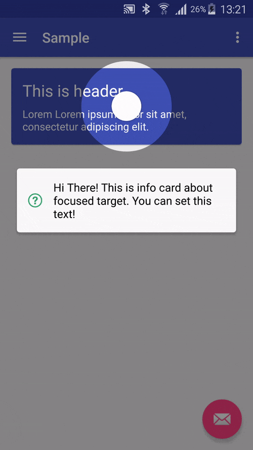
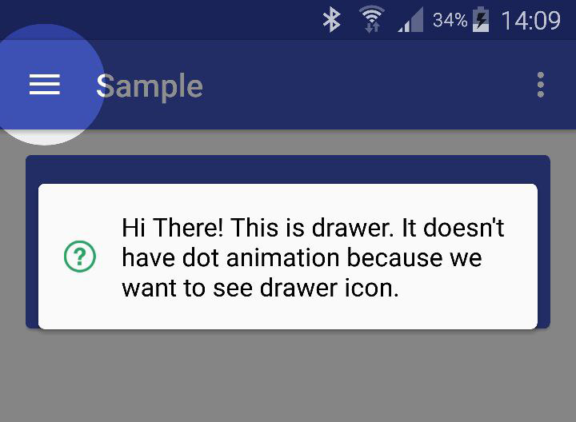
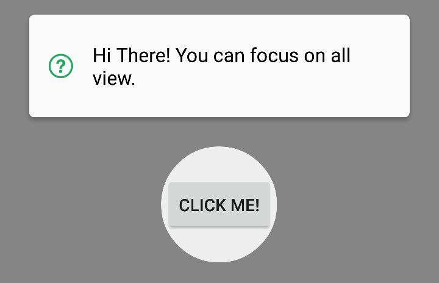
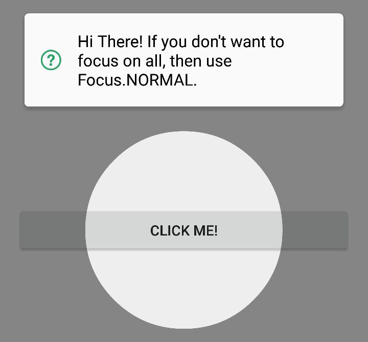
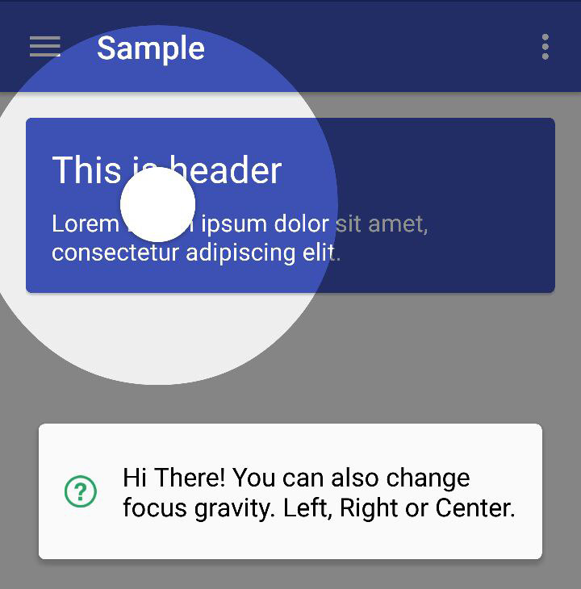
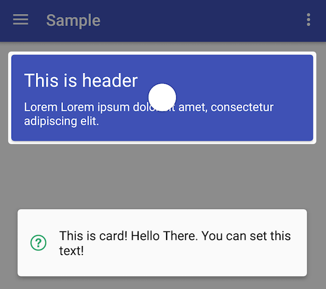

# MaterialIntroView
[](https://github.com/iammert/MaterialIntroView/actions/workflows/android.yml)
[](https://jitpack.io/#iammert/MaterialIntroView)

Material Intro View is a showcase android library.

We saw this kind of showcase on [Fabulous App](http://www.thefabulous.co/) and we love it. Then decided to create showcase just like it.

# Screen


# Usage
```java
new MaterialIntroView.Builder(this)
                .enableDotAnimation(true)
				.enableIcon(false)
                .setFocusGravity(FocusGravity.CENTER)
                .setFocusType(Focus.MINIMUM)
                .setDelayMillis(500)
                .enableFadeAnimation(true)
                .performClick(true)
                .setInfoText("Hi There! Click this card and see what happens.")
                .setShape(ShapeType.CIRCLE)
                .setTarget(view)
                .setUsageId("intro_card") //THIS SHOULD BE UNIQUE ID
                .show();
```

# Import
settings.gradle
```groovy
dependencyResolutionManagement {
    repositories {
        google()
        mavenCentral()
        maven { url "https://jitpack.io" }
    }
}
```

Module build.gradle
```groovy
dependencies {
    implementation 'com.github.iammert:MaterialIntroView:2.0.0'
}
```

Version 2.0.0 requires AndroidX and minSdk 21. Use `1.6.0` if your project
still depends on the support library.

# Builder Methods
```java
.setMaskColor(Color.Blue) 
```
```java
.setDelayMillis(3000) //starts after 3 seconds passed
```
```java
.enableFadeAnimation(true) //View will appear/disappear with fade in/out animation
```
```java
//ie. If your button's width has MATCH_PARENT.
//Focus.ALL is not a good option. You can use
//Focus.MINIMUM or Focus.NORMAL. See demos below.
.setFocusType(Focus.MINIMUM)
.setFocusType(Focus.NORMAL)
.setFocusType(Focus.ALL)
```
```java
//ie. You can focus on left of RecyclerView list item.
.setFocusGravity(FocusGravity.LEFT)
.setFocusGravity(FocusGravity.CENTER)
.setFocusGravity(FocusGravity.RIGHT)
//START and END follow the layout direction (RTL aware)
.setFocusGravity(FocusGravity.START)
.setFocusGravity(FocusGravity.END)
```
```java
.setTarget(myButton) //Focus on myButton
```
```java
.setTargetPadding(30) //add 30px padding to focus circle
```
```java
.setInfoText("This is info text!") //Setting text will enable info dialog
```
```java
.setTextColor(Color.Black) //Info dialog's text color is set to black
```
```java
.setInfoText(R.string.intro_text) //String resources are supported too
```
```java
.setInfoTextSize(30) //Change text size
```
```java
.setInfoCardBackgroundColor(Color.DKGRAY) //Info card color, white by default
.setIconTint(Color.WHITE) //Tint the info card icon
.setIcon(R.drawable.ic_lightbulb) //Replace the default icon
```
```java
.setShape(ShapeType.CIRCLE) //Change shape of focus area
.setShape(ShapeType.RECTANGLE) //Change shape of focus area
.setRectCornerRadius(0) //Corner radius of the rectangle in px, defaults to the target padding
```
```java
.setCustomShape(Shape shape) //Use custom shape
```
```java
// Allow this showcase overlay to only show up once. Prevents multiple screens from showing at the same time.
// Useful if you wish to show a tour step in a code that gets called multiple times
.setIdempotent(true)
```
```java
.setUsageId("intro_fab_button") //Store intro view status whether it is learnt or not
```
```java
.enableDotAnimation(true) //Shows dot animation center of focus area
```
```java
.enableIcon(false) //Turn off helper icon, default is true
```
```java
.performClick(true) //Trigger click operation when user click focused area.
```
```java
.dismissOnBackPress(false) //Back dismisses the intro by default, including predictive back
```
```java
//If you don't want to perform click automatically
//You can disable perform clik and handle it yourself
.setListener(new MaterialIntroListener() {
                    @Override
                    public void onUserClicked(String materialIntroViewId) {
                        // Called when the intro is dismissed
                    }

                    @Override
                    public void onIntroShown(String materialIntroViewId) {
                        // Optional, called when the intro becomes visible
                    }
                })
```

Intros without a usage id are not persisted and are shown every time.

# Sequence
Show several intros one after another. Intros that were already displayed are skipped.
```java
new MaterialIntroSequence()
        .add(new MaterialIntroView.Builder(this).setTarget(searchView).setInfoText("Search songs").setUsageId("search"))
        .add(new MaterialIntroView.Builder(this).setTarget(shareView).setInfoText("Share with friends").setUsageId("share"))
        .setOnCompleteListener(() -> { /* all intros were shown */ })
        .start();
```

# Reset
```java
PreferencesManager preferences = new PreferencesManager(context);
preferences.reset("intro_card"); //Show a single intro again
preferences.resetAll(); //Show every intro again
```
# Configuration Method
```java
//Create global config instance to not write same config to builder
//again and again.
MaterialIntroConfiguration config = new MaterialIntroConfiguration();
config.setDelayMillis(1000);
config.setFadeAnimationEnabled(true);
...
.setConfiguration(config) //
```

# Use Custom Shapes
You can use your own highlight shapes if Circle and Rectangle do not work for you. See source for `Circle` and `Rect` for implementation example.
```java
public class MyShape extends Shape {
    // ... your implementation
}

//... in your app code

.setCustomShape(MyShape shape)

```

# Demos





# Changelog
See [CHANGELOG.md](CHANGELOG.md).

# Authors

[Mert SIMSEK](https://github.com/iammert)

[Murat Can BUR](https://github.com/muratcanbur)


# Docs
[Chinese Doc](http://www.jianshu.com/p/1d2dcbc1e0f2)


License
--------


    Copyright 2015 Mert Şimşek.

    Licensed under the Apache License, Version 2.0 (the "License");
    you may not use this file except in compliance with the License.
    You may obtain a copy of the License at

       http://www.apache.org/licenses/LICENSE-2.0

    Unless required by applicable law or agreed to in writing, software
    distributed under the License is distributed on an "AS IS" BASIS,
    WITHOUT WARRANTIES OR CONDITIONS OF ANY KIND, either express or implied.
    See the License for the specific language governing permissions and
    limitations under the License.


